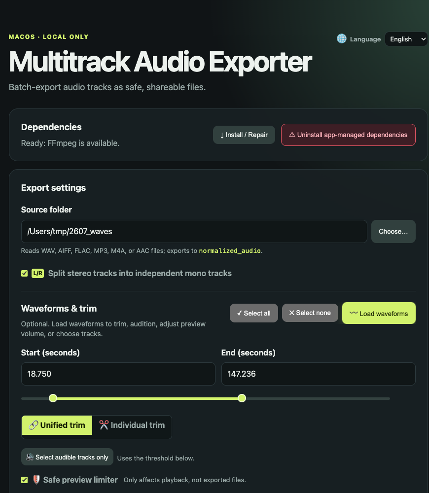
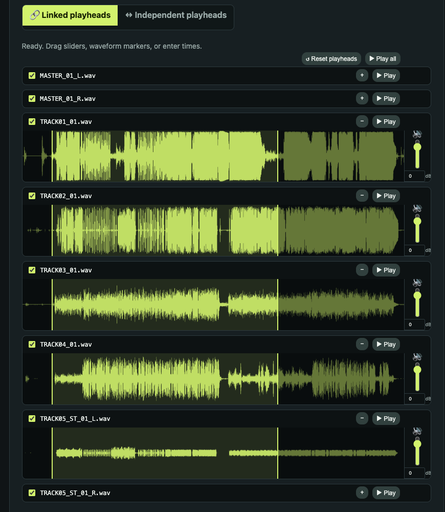
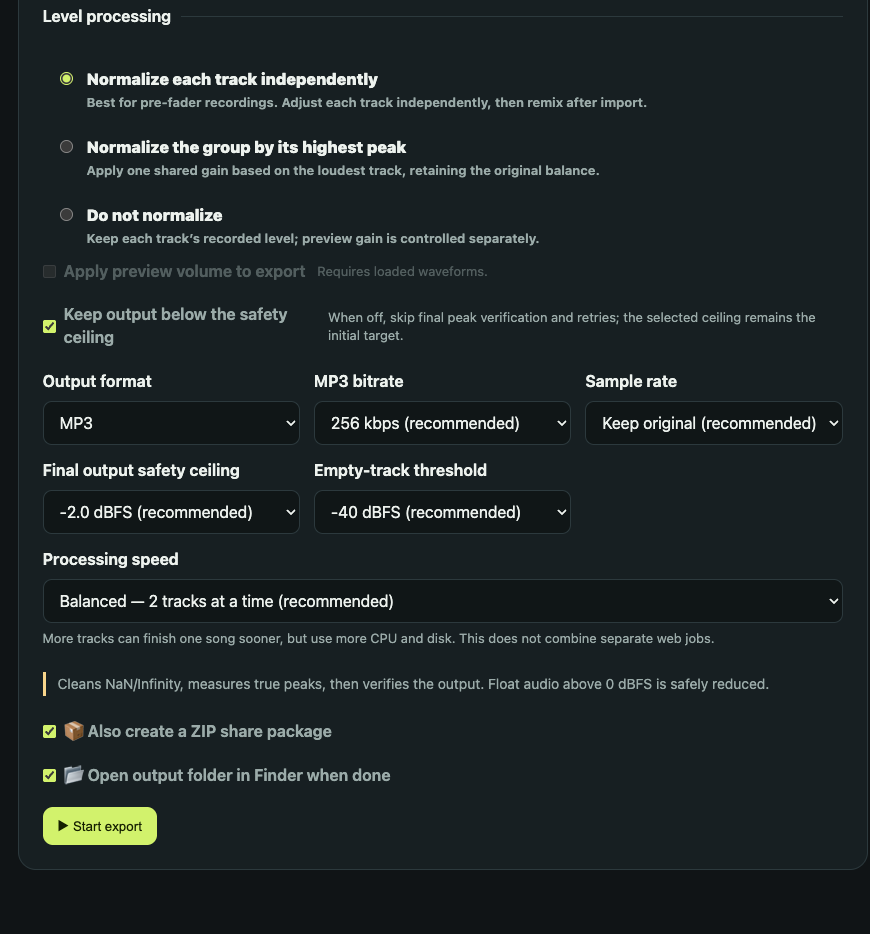

# Multitrack Audio Exporter

A macOS-local app for batch-exporting multitrack recordings as safe, shareable files. All processing stays on your Mac.

> macOS only. The interface includes English, Simplified Chinese, Traditional Chinese, Japanese, Spanish, French, and Korean.

To add a UI language, add a complete `web/locales/<code>.json` file; the app discovers it automatically.

## Highlights

- <strong>32-bit float WAV input</strong> with safe handling of signals above 0 dBFS.
- <strong>Input:</strong> WAV, AIFF, FLAC, MP3, M4A, and AAC.
- <strong>Output:</strong> MP3, M4A (AAC), or WAV at 32-bit float, 24-bit PCM, or 16-bit PCM.
- <strong>Flexible preparation:</strong> waveform preview, single-track trim audition, track selection, shared or individual trim, and three level-processing modes.
- <strong>Safe audition:</strong> per-track preview volume and mute controls from −60 dB to +12 dB, plus an optional playback limiter.
- <strong>Flexible levels:</strong> normalize tracks, preserve relative levels, or skip normalization; separately choose whether to apply preview gains and enforce the safety ceiling.
- <strong>Stereo splitting:</strong> optionally split stereo files into independent left/right mono tracks for separate preview, trimming, and export.
- <strong>Easy sharing:</strong> optional ZIP package and a local-only workflow.

## Interface preview







## Quick start

Two distributions are maintained: the source version below and a self-contained app.

### Packaged app (Apple Silicon)

Download the `.app.zip` asset from [GitHub Releases](https://github.com/yankaiyu/Multitrack-Audio-Exporter/releases), extract it, move the app to Applications and open it. Python, FFmpeg and FFprobe are included; no Homebrew or compilation is needed. This initial build targets **Apple Silicon (M1 or later), macOS 26+**; Intel Macs are not supported by this binary.

This app is not Developer ID signed or notarized. After trying to open it, use **System Settings → Privacy & Security → Open Anyway** if macOS blocks it. Only allow a download you trust. Managed Macs may prohibit this. Click the Dock icon or double-click the app again to reopen the browser. To stop the server and background tasks, select the app in the Dock and press **⌘Q**, or use **♫ → Quit** in the menu bar. Closing the browser does not quit the app.

### Source version

The source workflow remains available, including dependency installation/removal. It uses your local Python and FFmpeg rather than bundled binaries. macOS may also ask permission to open a downloaded script.

1. Double-click `start.command`.
2. Open <http://127.0.0.1:8765> if your browser does not open automatically.
3. Click <strong>Install / Repair</strong> on first use to install FFmpeg through Homebrew.
4. Choose an audio folder, adjust the export settings, and start the export.

Files are written to `normalized_audio` inside the source folder.

## Requirements

These requirements apply to the source version only. Maintainers can build the app using [the packaging guide](packaging/README.md).

- macOS with Python 3.
- FFmpeg. The app can install it through Homebrew.

The red <strong>Uninstall app-managed dependencies</strong> button removes only FFmpeg that this app recorded as its own installation. Homebrew’s shared dependencies are retained.

## Tests

Tests generate synthetic audio only; no recordings are used.

```bash
python3 -m unittest discover -s tests
```

See [CHANGELOG.md](CHANGELOG.md) for detailed behavior and release notes.

---

# 多轨音频批量导出

这是一个仅在 macOS 本机运行的多轨音频批量导出工具，可生成安全、便于分享的文件。全部处理都在你的 Mac 上完成。

> 仅支持 macOS；界面提供简体中文、繁体中文、英文、日文、西班牙语、法语和韩文。

如需新增界面语言，只需添加完整的 `web/locales/<语言代码>.json` 文件；程序会自动发现。

## 主要功能

- <strong>重点支持 32-bit float WAV 输入</strong>，可安全处理高于 0 dBFS 的信号。
- <strong>输入：</strong> WAV、AIFF、FLAC、MP3、M4A、AAC。
- <strong>输出：</strong> MP3、M4A（AAC），或 32-bit float、24-bit PCM、16-bit PCM WAV。
- <strong>灵活准备：</strong> 波形预览、单轨裁剪试听、轨道选择、统一或逐轨裁剪，以及三种音量处理模式。
- <strong>安全试听：</strong> 每轨可独立调整 −60 dB 至 +12 dB 的试听音量或静音，并可选开启试听限幅器。
- <strong>灵活音量：</strong> 可逐轨标准化、保持相对响度或跳过标准化，并分别选择是否应用试听增益及是否进行最终安全峰值复检。
- <strong>立体声拆分：</strong> 可将立体声文件拆为独立的左右单声道轨道，分别预览、裁剪和导出。
- <strong>方便分享：</strong> 可选 ZIP 分享包，全部本机处理。

## 快速开始

保留两种分发方式：下方的源码版，以及自包含应用版。

### 打包应用版（Apple Silicon）

在 [GitHub Releases](https://github.com/yankaiyu/Multitrack-Audio-Exporter/releases) 下载 `.app.zip` 附件，解压后将应用拖入 Applications 并打开。内置 Python、FFmpeg 和 FFprobe，无需 Homebrew 或编译。首版支持 **Apple Silicon（M1 及更新芯片）、macOS 26+**；此安装包不支持 Intel Mac。

暂未进行 Developer ID 签名或 Apple 公证。尝试打开后若被拦截，可在 **系统设置 → 隐私与安全性 → 仍要打开** 中放行，请只放行可信来源。受管理的 Mac 可能禁止此操作。点击 Dock 图标或再次双击应用可重新打开网页。退出时，在 Dock 中选中本应用并按 **⌘Q**，或使用菜单栏 **♫ → 退出**，即可停止服务器及后台任务。关闭网页不会退出应用。

### 源码版

继续保留原有源码启动与依赖安装/卸载流程，使用本机 Python 和 FFmpeg。macOS 对下载的脚本也可能提示打开权限。

1. 双击 `start.command`。
2. 若浏览器未自动打开，访问 <http://127.0.0.1:8765>。
3. 首次使用时点击 <strong>安装 / 修复依赖</strong>，通过 Homebrew 安装 FFmpeg。
4. 选择音频文件夹，调整导出设置后开始转换。

输出文件会写入源文件夹内的 `normalized_audio`。

## 环境要求

仅适用于源码版。维护者可按[打包说明](packaging/README.md)构建应用。

- 安装 Python 3 的 macOS。
- FFmpeg；可由本工具通过 Homebrew 安装。

红色的 <strong>卸载本工具安装的依赖</strong> 按钮只会删除本工具记录为自身安装的 FFmpeg；Homebrew 的共享间接依赖会保留。

## 测试

测试只生成合成音频，不会读取或使用任何真实录音文件。

```bash
python3 -m unittest discover -s tests
```

具体行为与版本记录见 [CHANGELOG.md](CHANGELOG.md)。
